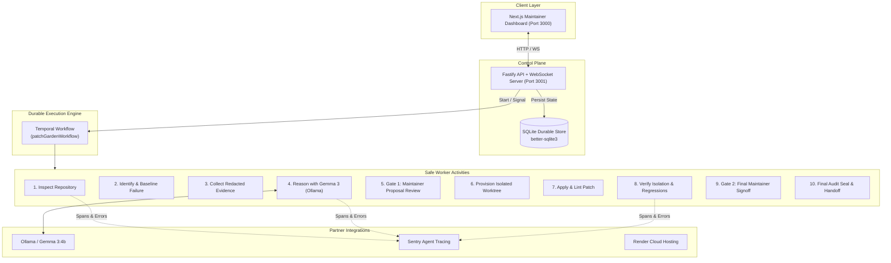

# 🌱 PatchGarden

> **An AI maintenance engineer that never rushes a patch.**

[](https://hacktoberfest.com/)
[](https://hacktoberfest.com/)
[](https://opensource.org/licenses/MIT)
[](https://temporal.io/)
[](https://ai.google.dev/gemma)
[](https://sentry.io/)

---

## 📖 The Problem

Most AI coding agents optimize for **raw speed and code volume** — generating massive, multi-file diffs in seconds, frequently hallucinating dependencies, introducing subtle behavioral regressions, and leaving maintainers with zero durable evidence or audit trails.

**PatchGarden takes the opposite philosophy: Slow and Steady.**

PatchGarden is an AI-assisted maintenance engineer designed for open-source maintainers. It never guesses. It never rushes. It:
1. **Reproduces** the failure against an untouched baseline.
2. **Collects** sanitized, redacted evidence of only the relevant context.
3. **Reasons** with local open-weights (**Gemma 3**) to propose the minimal viable diff.
4. **Validates** path safety before touching any file.
5. **Applies** the patch inside an **isolated Git worktree**.
6. **Verifies** the repair against regression suites.
7. **Waits** for human maintainer approval at every critical gate before touching `main`.
8. **Preserves** complete, immutable cryptographic audit evidence of every step.

---

## 🏛️ Architecture

PatchGarden is built with a distributed, fault-tolerant workflow architecture orchestrated by **Temporal**, backed by **SQLite** persistence, and observable end-to-end with **Sentry**.



---

## 🛡️ Safety & Security Principles

PatchGarden enforces defensive engineering at every layer:

- **Strict Path Guarding:** No path outside the designated workspace can ever be read, modified, or executed (`assertPathInWorkspace`). Prevents directory traversal attacks (`../../etc/passwd`).
- **Symlink Jail:** Prevents malicious symlink escapes.
- **Secret Redaction:** Logs, error outputs, and model prompts automatically redact API keys, GitHub tokens, AWS credentials, and `.env` contents.
- **Isolated Worktrees:** Candidate repairs are applied and tested inside temporary Git worktrees — never on the primary checkout or active working tree.
- **Non-Negotiable Human Gates:** The AI cannot push to `main` or merge branches autonomously. Maintainers must review and approve proposals via Temporal signals.

---

## 🚀 Quickstart

### Prerequisites
- **Node.js** >= 20.x
- **Docker & Docker Compose**
- **Git**

### 1. Clone & Configure
```bash
git clone https://github.com/Neet2516/patchgarden.git
cd patchgarden
cp .env.example .env
```

### 2. Launch Local Infrastructure (Ollama + Temporal)
```bash
docker compose up -d ollama temporal
```

Pull the Gemma 3 model for local AI inference:
```bash
docker exec -it patchgarden-ollama ollama pull gemma:latest
```

### 3. Install Dependencies & Build Monorepo
```bash
npm install
npm run build
```

### 4. Run the Stack
```bash
# Terminal 1: Run the API Server
npm run dev -w packages/api

# Terminal 2: Run the Temporal Worker
npm run dev -w packages/worker

# Terminal 3: Run the Next.js Dashboard
npm run dev -w packages/web
```

Open [http://localhost:3000](http://localhost:3000) to view the Maintainer Dashboard.

> 📖 **Looking for a full walkthrough?** Check out the [Complete Workflow & Quickstart Guide](docs/WORKFLOW_GUIDE.md) featuring a real step-by-step example with `fixtures/broken-calc`.

---

## 📦 Monorepo Structure

```
patchgarden/
├── AGENTS.md                  # Operating instructions for AI pair-programmers
├── docker-compose.yml         # Container definitions (Ollama, Temporal, App)
├── agent/                     # Safety policies, charters, failure recovery
├── memory/                    # Project memory, state tracking, decision records
├── docs/                      # PRD, Technical Architecture, Threat Model
├── tasks/                     # Phase execution specifications
├── fixtures/                  # Reproducible test fixtures & broken repos
├── packages/
│   ├── core/                  # Domain types, SQLite persistence, PathGuard, Redactor
│   ├── worker/                # Temporal workflow, Gemma 3 integration, 8 activities
│   ├── api/                   # Fastify server, WebSocket broadcaster, Temporal client
│   └── web/                   # Next.js 14 App Router maintainer dashboard
└── scripts/                   # Verification, healthcheck, and demo scripts
```

---

## 🏆 Hacktoberfest 2026 — Theme: Slow and Steady

PatchGarden was built specifically for the **Hacktoberfest 2026 Open-Source AI Challenge (Week 3)**.

| Requirement | Implementation in PatchGarden |
|-------------|------------------------------|
| **Theme Alignment** | Favors deliberative verification, baseline testing, and human review gates over rapid, unchecked generation. |
| **Local AI Inference** | Leverages Google's **Gemma 3** via Ollama for zero-cloud, privacy-preserving maintenance reasoning. |
| **Durable Execution** | Uses **Temporal** workflows with checkpoints to withstand network blips, reboots, and multi-day maintainer review pauses. |
| **Enterprise Observability** | Integrated with **Sentry** Agent Tracing for latency breakdown and activity monitoring. |
| **Reproducibility** | Complete JSONL audit logs and evidence bundles saved for every patch candidate. |

---

## 📄 License

MIT © 2026 [Navneet Sinha](https://github.com/Neet2516).
