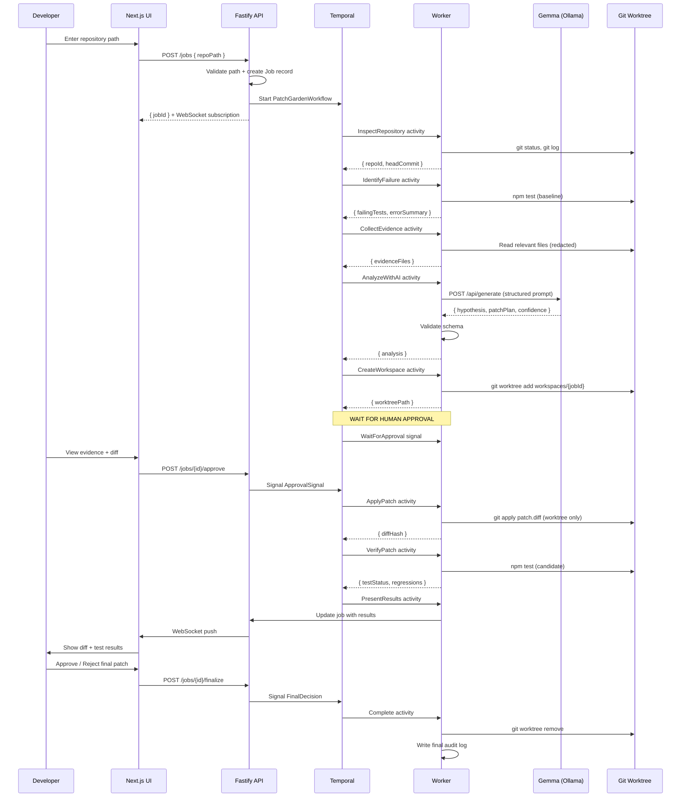
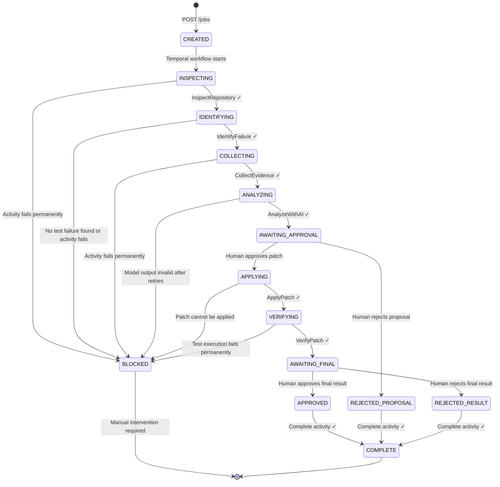
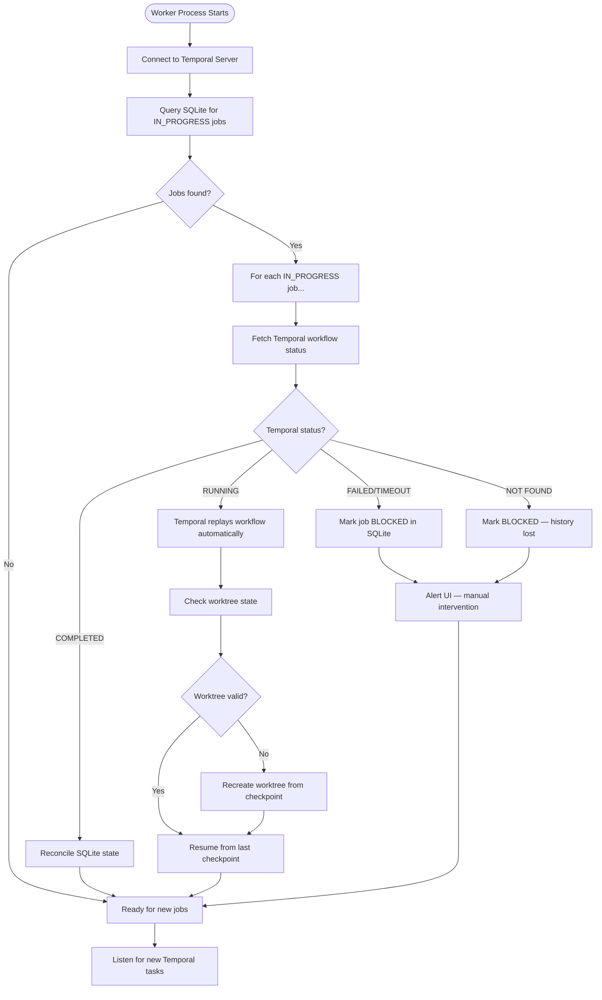

# Technical Architecture — PatchGarden

> **Version:** 1.0.0  
> **Last Updated:** 2026-10-25

---

## 1. System Architecture Diagram

```mermaid
graph TB
    subgraph "Browser"
        UI[Next.js Frontend<br/>port 3000]
    end

    subgraph "Docker Compose Stack"
        API[Fastify API<br/>port 3001]
        TEMPORAL[Temporal Server<br/>port 7233]
        OLLAMA[Ollama Container<br/>port 11434<br/>gemma3:4b]
        WORKER[Temporal Worker<br/>Node.js process]
    end

    subgraph "Persistent Storage"
        SQLITE[(SQLite<br/>patchgarden.db)]
        LOGS[JSONL Logs<br/>logs/*.jsonl]
        EVIDENCE[Evidence Artifacts<br/>jobs/{id}/evidence/]
        WORKTREES[Git Worktrees<br/>workspaces/{jobId}/]
    end

    subgraph "External Services"
        SENTRY[Sentry<br/>Agent Tracing]
        RENDER[Render<br/>Deployment]
    end

    UI -->|REST + WebSocket| API
    API -->|Temporal SDK| TEMPORAL
    API -->|Read| SQLITE
    TEMPORAL -->|Dispatch| WORKER
    WORKER -->|Ollama HTTP API| OLLAMA
    WORKER -->|Write| SQLITE
    WORKER -->|Append| LOGS
    WORKER -->|Write| EVIDENCE
    WORKER -->|git worktree| WORKTREES
    WORKER -->|Sentry SDK| SENTRY
    API -->|Sentry SDK| SENTRY
    RENDER -.->|hosts| UI
    RENDER -.->|hosts| API
```

---

## 2. End-to-End Repair Workflow



---

## 3. Job State Machine



---

## 4. Failure Recovery Diagram



---

## 5. Package Dependencies

```
root/
├── packages/core          ← No external runtime deps except better-sqlite3
│   └── depends on: better-sqlite3, zod, winston
│
├── packages/api           ← HTTP server
│   └── depends on: core, fastify, @fastify/websocket, @temporalio/client
│
├── packages/worker        ← Temporal worker + AI
│   └── depends on: core, @temporalio/worker, @temporalio/activity
│       axios (Ollama client), zod, @sentry/node
│
└── packages/web           ← Next.js frontend
    └── depends on: react, next, swr, diff2html, prism-react-renderer
```

---

## 6. API Endpoints

| Method | Path | Description |
|--------|------|-------------|
| POST | `/jobs` | Create a new maintenance job |
| GET | `/jobs` | List all jobs |
| GET | `/jobs/:id` | Get job details |
| GET | `/jobs/:id/evidence` | Get evidence artifacts |
| GET | `/jobs/:id/diff` | Get patch diff |
| POST | `/jobs/:id/approve-proposal` | Approve the AI proposal |
| POST | `/jobs/:id/reject-proposal` | Reject the AI proposal |
| POST | `/jobs/:id/approve-result` | Approve the verified result |
| POST | `/jobs/:id/reject-result` | Reject the verified result |
| GET | `/jobs/:id/logs` | Stream job logs |
| GET | `/health` | Health check |
| GET | `/model/status` | Ollama model availability |
| GET | `/temporal/status` | Temporal server connectivity |
| WS | `/jobs/:id/live` | WebSocket for real-time job updates |

---

## 7. Database Schema

```sql
-- Core job record
CREATE TABLE jobs (
    id TEXT PRIMARY KEY,
    repo_path TEXT NOT NULL,
    repo_head_commit TEXT,
    repo_branch TEXT,
    repo_remote TEXT,
    status TEXT NOT NULL DEFAULT 'CREATED',
    stage TEXT NOT NULL DEFAULT 'CREATED',
    workflow_id TEXT,
    run_id TEXT,
    worktree_path TEXT,
    test_command TEXT,
    baseline_result TEXT,  -- JSON
    analysis TEXT,         -- JSON
    patch_diff TEXT,
    diff_hash TEXT,
    candidate_result TEXT, -- JSON
    approval_state TEXT DEFAULT 'PENDING',
    approved_by TEXT,
    rejection_reason TEXT,
    retry_count INTEGER DEFAULT 0,
    model_id TEXT,
    error_code TEXT,
    error_message TEXT,
    evidence_dir TEXT,
    created_at TEXT NOT NULL,
    updated_at TEXT NOT NULL,
    completed_at TEXT
);

-- Checkpoint records for recovery
CREATE TABLE checkpoints (
    id TEXT PRIMARY KEY,
    job_id TEXT NOT NULL REFERENCES jobs(id),
    stage TEXT NOT NULL,
    evidence_hash TEXT,
    worker_version TEXT,
    temporal_run_id TEXT,
    attempt INTEGER NOT NULL DEFAULT 1,
    created_at TEXT NOT NULL
);

-- Audit event log (append-only projection of JSONL)
CREATE TABLE audit_events (
    id TEXT PRIMARY KEY,
    job_id TEXT,
    event_type TEXT NOT NULL,
    actor TEXT,
    payload TEXT,  -- JSON
    created_at TEXT NOT NULL
);

CREATE INDEX idx_jobs_status ON jobs(status);
CREATE INDEX idx_jobs_created ON jobs(created_at);
CREATE INDEX idx_checkpoints_job ON checkpoints(job_id);
CREATE INDEX idx_audit_job ON audit_events(job_id);
```
